<p align="center">
  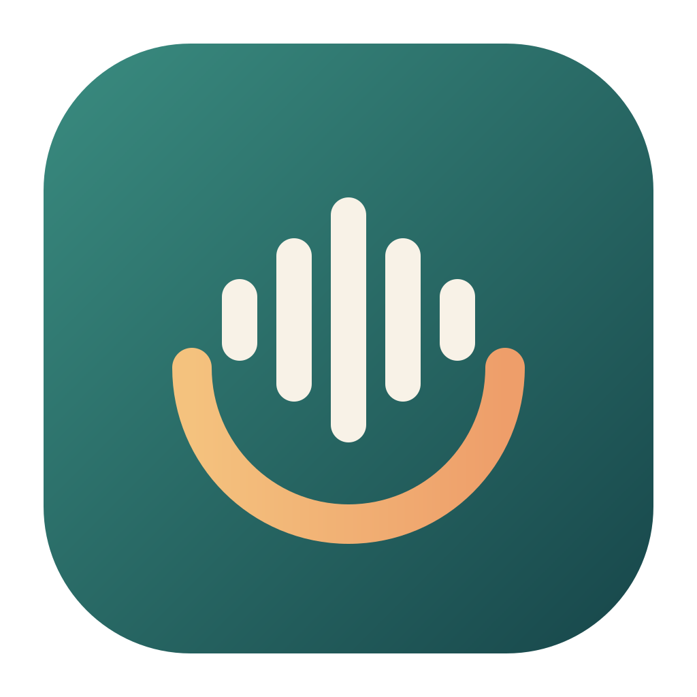
</p>

<h1 align="center">Vocalkeep</h1>

<p align="center">
  <strong>Bank your own voice. Free, open source, and private.</strong><br />
  A calm recording studio for people with ALS/MND or facing throat surgery, so their
  communication app can one day speak in <em>their</em> voice instead of a stranger's.
</p>

<p align="center">
  <a href="https://github.com/lobojoel2003/Vocalkeep/actions/workflows/ci.yml"></a>
  <a href="https://github.com/lobojoel2003/Vocalkeep/releases/latest"></a>
  <a href="LICENSE"></a>
  
  
</p>

---

<p align="center">
  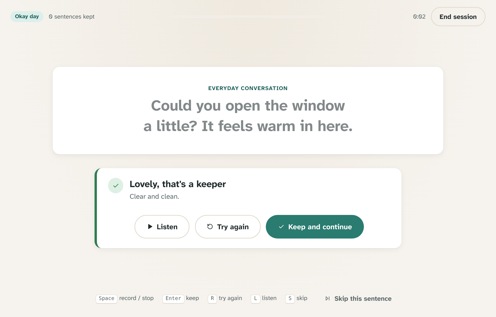
</p>

## Contents

- [Why Vocalkeep](#why-vocalkeep)
- [What it does](#what-it-does)
- [Screenshots](#screenshots)
- [How it works](#how-it-works)
- [Install](#install)
- [Recording your voice](#recording-your-voice)
- [Building your voice](#building-your-voice)
- [Using your voice](#using-your-voice)
- [Licences of starting voices](#licences-of-starting-voices)
- [Privacy](#privacy)
- [Building from source](#building-from-source)
- [Versions and releases](#versions-and-releases)
- [Contributing](#contributing)
- [Licence and credits](#licence-and-credits)

## Why Vocalkeep

People with ALS (motor neurone disease), or facing surgery such as a laryngectomy, often lose
the ability to speak. **Voice banking** lets them record their voice now, so a text-to-speech voice
built from those recordings can later speak for them, with their accent, warmth and character,
through their communication (AAC) app.

Today, that costs money, takes a long time, and leaves the voice on someone else's servers.
From the University of Iowa's 2025
[Voice Banking Guide](https://csd.uiowa.edu/sites/csd.uiowa.edu/files/2025-08/Voice_Banking_Guide.pdf):

| Service | Cost | Notes |
| --- | --- | --- |
| ModelTalker | $100 | About 7 hours of recording, up to 3,155 sentences |
| SpeakUnique | $235 | |
| CereVoice Me | $673 | |
| VocaliD (full voice) | $1,500 | |
| Message banking | Free | Saves recorded phrases only; it can't say new words |

The same guide notes that only ModelTalker and SpeakUnique promise to keep storing your voice,
and ModelTalker's lab says it is
["transferring the technology"](https://asel.udel.edu/speech/clinicians.html) to a small company.
Every option found is paid, closed, or both, and **no open-source voice banking app existed.**

Vocalkeep fills that gap:

| | Vocalkeep | Typical services |
| --- | --- | --- |
| Price | **Free** | $100 to $1,500 |
| Where your voice lives | **On your computer**, as plain files you own | The vendor's servers |
| If the company disappears | Nothing changes: the voice bank and voice are yours | The voice may be lost |
| Source code | **Open** (GPL-3.0-or-later) | Closed |
| Sessions | Short and fatigue-aware, with a check-in each day | Long scripts |
| Recording quality | Checked on every take, with kind tips | Varies |
| New words | Yes, a full text-to-speech voice | Message banking: no |
| Where the voice works | Saywell, Android, Windows, Linux, NVDA, macOS | Usually one vendor's apps |

## What it does

- **A calm recording studio.** One sentence at a time in large, highly legible type; a big record
  button; full keyboard control (Space, Enter, R, L, S). Nothing flashes, nothing scolds.
- **"How does your voice feel today?"** Strong, okay or tired. Vocalkeep sizes each session to
  match. Tired days get a handful of short sentences, because every one counts.
- **Gentle care built in.** A sip-of-water reminder every ten sentences, a clear "good place to
  stop", and a session summary that celebrates milestones. No streaks, no guilt: rest days are good days.
- **Every take checked** the moment it's recorded: clipping, level, background noise,
  signal-to-noise, words cut off, long pauses, and whether the length fits the sentence. Problems
  come with specific, kind tips ("A little quiet. Move a little closer to the microphone"). A room
  check measures background noise before you start. [Details](docs/quality-checks.md)
- **1,631 built-in sentences**: phonetically rich sentences from CMU ARCTIC, everyday conversation
  and short phrases written for Vocalkeep, plus **your own phrases**: names of family and pets,
  places, the things you always say.
- **A progress view that fills up as your voice takes shape**, with milestones from *First words*
  to *Complete*, and how many of English's speech sounds and sound pairs you've covered.
- **Legacy messages.** Birthday wishes, wedding-day advice, bedtime stories, "I love you", kept
  exactly as said and never turned into a computer voice. Family members can record too. Export
  them as plain audio files with a little web page that plays them anywhere.
- **The voice builder** fine-tunes an open [Piper](https://github.com/OHF-Voice/piper1-gpl) voice on
  your recordings and exports it as an ONNX voice that runs offline, in real time, on a phone or
  an old laptop.
- **Your voice, everywhere you need it**: directly into [Saywell](https://github.com/lobojoel2003/Saywell),
  as a system voice on Android (SherpaTTS), Windows (SAPI 5 via VoiceGarden) and Linux
  (speech-dispatcher), in NVDA, and in Piper apps on macOS and iPhone.
- **Licence-aware.** Every starting voice shows its licence and whether commercial use is allowed,
  and public-domain voices are recommended. [Why this matters](#licences-of-starting-voices)
- **Accessible**: Atkinson Hyperlegible Next, four text sizes, light, dark and yellow-on-black
  high-contrast themes, reduced motion, screen-reader labels throughout.

## Screenshots

| Today: a gentle check-in | Progress: your voice taking shape |
| --- | --- |
| 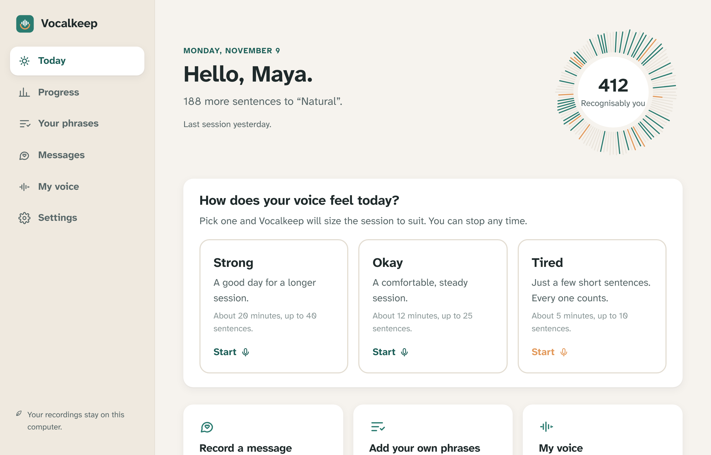 | 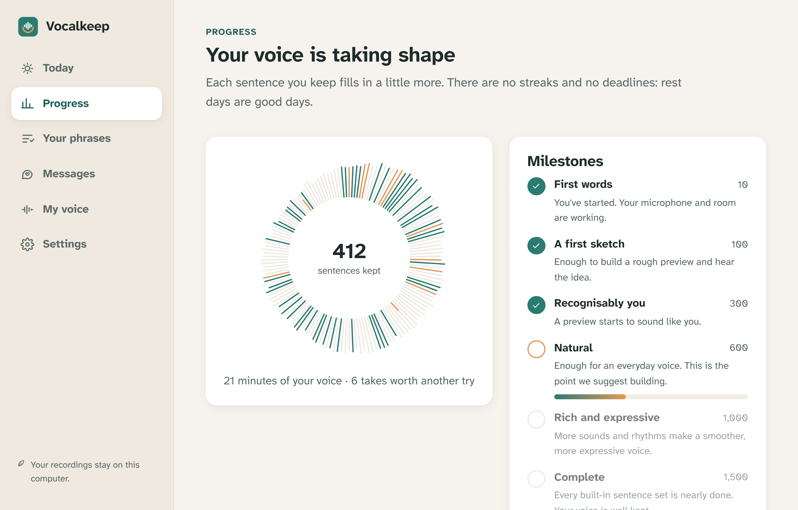 |
| **Recording** | **A gentle note, in the dark theme** |
| 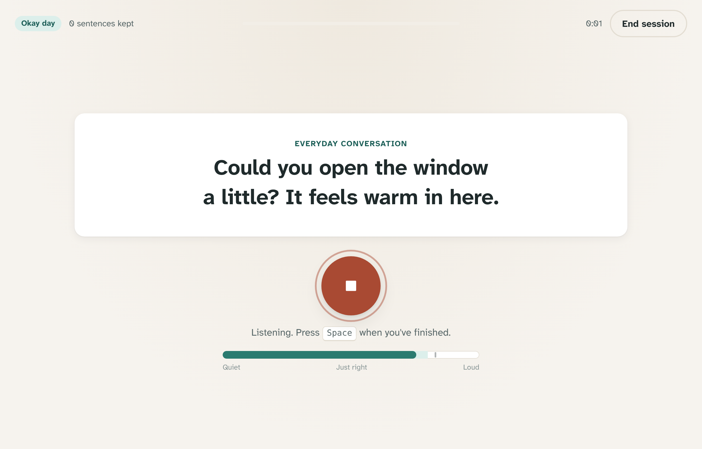 | 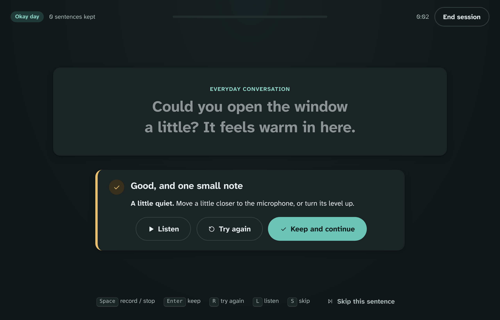 |
| **Messages for family** | **My voice: build it, then use it anywhere** |
| 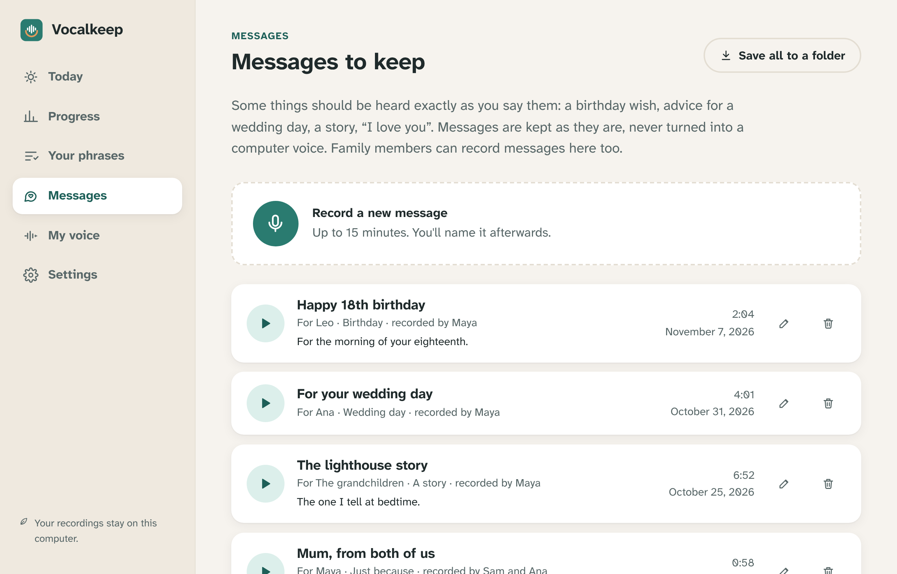 | 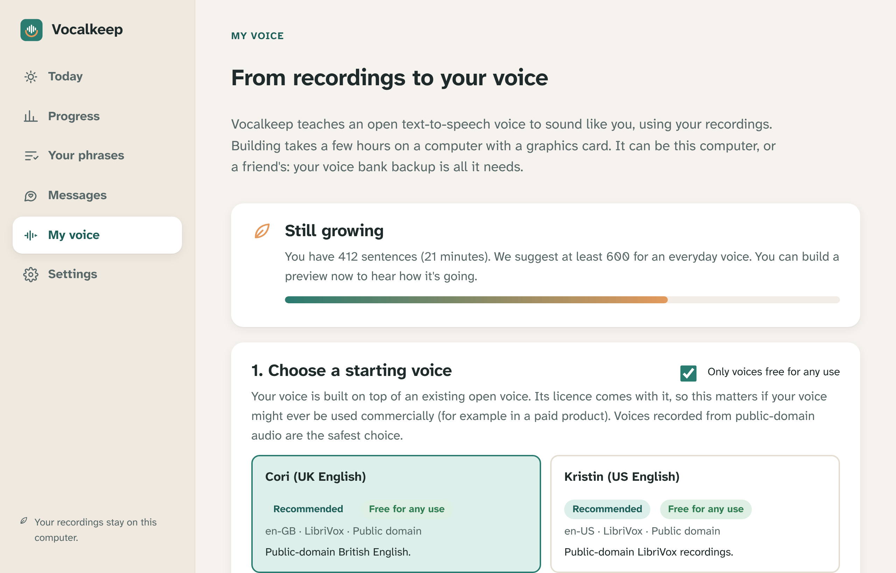 |
| **High contrast** | **First run** |
| 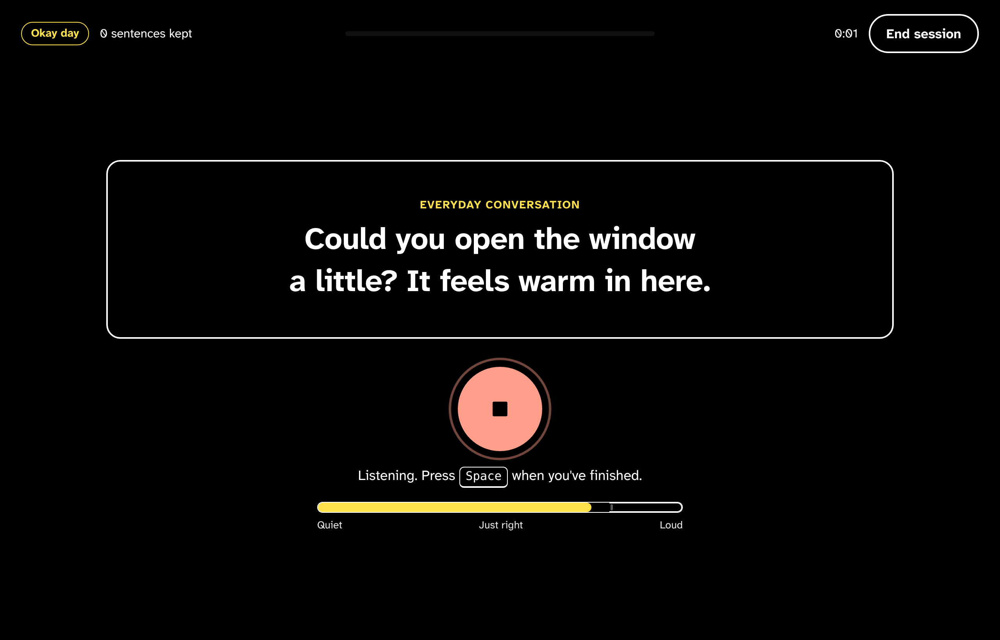 | 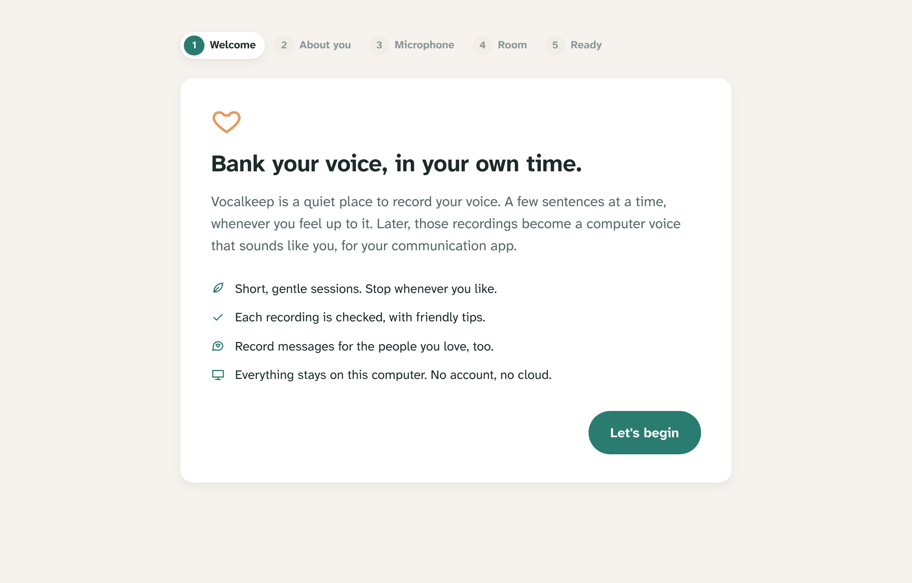 |

<sub>Screenshots use the interface's built-in demo voice bank (`npm run dev` in `desktop/`). No real
person's recordings were used.</sub>

## How it works

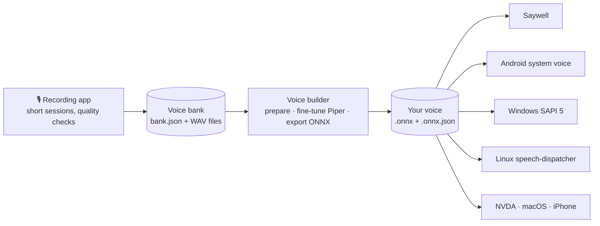

1. **Record** in the app, a little at a time. Everything is saved as you go, in a plain folder.
2. **Build** your voice on a computer with a graphics card: yours, a friend's, or a clinic's.
   The app can run the builder for you, or you hand over a backup zip.
3. **Use** it: install it as a system voice, or put it into Saywell or another app.

More detail: [architecture](docs/architecture.md) · [voice bank format](docs/voice-bank-format.md).

## Install

Download the recording app from the [latest release](https://github.com/lobojoel2003/Vocalkeep/releases/latest):

| Computer | File |
| --- | --- |
| Windows 10 and 11 | `Vocalkeep_<version>_x64-setup.exe` (no admin needed) or `Vocalkeep_<version>_x64_en-US.msi` |
| macOS 11+ (Apple silicon) | `Vocalkeep_<version>_aarch64.dmg` |
| Debian, Ubuntu | `Vocalkeep_<version>_amd64.deb` |
| Fedora, openSUSE | `Vocalkeep-<version>-1.x86_64.rpm` |
| Any Linux | `Vocalkeep_<version>_amd64.AppImage` |

Each release lists SHA-256 checksums. The installers aren't code-signed yet, so Windows may show
"Windows protected your PC" (choose **More info › Run anyway**) and macOS may need
**right-click › Open** the first time.

The **voice builder** is only needed on the computer that builds the voice:

```bash
pip install "vocalkeep[runtime] @ git+https://github.com/lobojoel2003/Vocalkeep#subdirectory=pipeline"
vocalkeep doctor
```

Or install the `vocalkeep-<version>-py3-none-any.whl` from the release. Training also needs
Piper's training code and a GPU; `vocalkeep doctor` explains exactly what to install. See
[docs/training.md](docs/training.md).

## Recording your voice

1. Open Vocalkeep. The first run asks your name, helps you choose and test a microphone, and
   listens to the room for four seconds.
2. Each day, answer **How does your voice feel today?** and read the sentences shown, in your
   normal voice. Keep, retry or listen back after each one.
3. Add **your own phrases** and record **messages** whenever you like.
4. **Back up** your voice bank regularly (Settings › Voice bank).

A guide for people banking their voice, their families and clinicians:
[docs/getting-started.md](docs/getting-started.md).

## Building your voice

When **Progress** reaches *Natural* (about 600 sentences, roughly 40 minutes of speech), open
**My voice**, choose a starting voice and press **Build my voice**, or on any computer with the
voice builder:

```bash
vocalkeep build "Maya voice bank.zip" --base en_GB-cori-medium -o voices
```

`--quick` builds a short preview first. Steps, timings and requirements:
[docs/training.md](docs/training.md).

## Using your voice

| Where | How |
| --- | --- |
| **Saywell** (Android AAC) | Save for Saywell, copy to the device, **Settings › Saywell voices › Install from a file** |
| **Android, every app** | The free SherpaTTS engine: **Manage languages › Install from SD card** |
| **Windows, every app** | `vocalkeep install <voice> --target windows`, then **Install to SAPI** in VoiceGarden |
| **Linux, every app** | `vocalkeep install <voice> --target linux` (speech-dispatcher, no root needed) |
| **NVDA** | The Sonata add-on: **Install from local file** |
| **macOS, iPhone, Piper apps** | Import the `.onnx` and `.onnx.json` |

Step-by-step instructions: [docs/using-your-voice.md](docs/using-your-voice.md).

## Licences of starting voices

Your voice is built on top of an open starting voice, and **its licence comes with it**. Most of
Piper's English voices were fine-tuned from `lessac`, whose recordings are **licensed for research
only**, so a voice built on them can't be used commercially. Vocalkeep shows every starting
voice's licence, recommends voices trained from scratch on public-domain recordings
(**LJ Speech**, **Kristin**, **Cori**), and `vocalkeep train --require-commercial` refuses
anything else.

The full table, with sources, plus the licences of popular voice-cloning models (several, such as
XTTS-v2 and F5-TTS, forbid commercial use): [docs/licences.md](docs/licences.md).

## Privacy

- No account, no analytics, no cloud. **The recording app never connects to the internet.**
- Your voice bank, messages and voices are ordinary files in a folder you can open, back up or delete.
- The voice builder downloads only the starting voice you chose, and uploads nothing.

See [PRIVACY.md](PRIVACY.md) and [SECURITY.md](SECURITY.md).

## Building from source

You need Rust (installed automatically from `rust-toolchain.toml`), Node.js 20+ and Python 3.10+.
On Debian or Ubuntu, Tauri also needs:

```bash
sudo apt install libwebkit2gtk-4.1-dev libgtk-3-dev libayatana-appindicator3-dev librsvg2-dev libasound2-dev patchelf
```

```bash
git clone https://github.com/lobojoel2003/Vocalkeep
cd Vocalkeep/desktop
npm install
npm run tauri dev       # run the app
npm run tauri build     # build installers for this computer
```

Tests and checks (all run in CI):

```bash
cargo test --workspace && cargo clippy --workspace --all-targets -- -D warnings
cd desktop && npm run lint && npm run check && npm test
cd ../pipeline && pip install -e ".[dev]" && ruff check . && mypy src && pytest
```

### Project layout

```text
crates/vocalkeep-core/   Rust: quality checks, voice bank, sentence sets, progress, exports
desktop/                 The recording app: Svelte 5 interface (src/) and Tauri 2 backend (src-tauri/)
pipeline/                The voice builder: Python package and `vocalkeep` command
shared/                  Quality thresholds, sentence sets and test recordings used by both
scripts/                 Versioning, release notes, sentence and fixture tools
docs/                    Guides, formats and screenshots
```

## Versions and releases

Vocalkeep follows [Semantic Versioning](https://semver.org/). One version, in [`VERSION`](VERSION),
is shared by the app, the core library and the voice builder; `scripts/bump-version.sh` updates
every manifest and CI checks they agree. Every build carries a **build number** (the CI run number)
and commit, shown in **Settings › About**.

Releases are made by pushing a `vX.Y.Z` tag (or from **Actions › Release**). The workflow runs the
full CI, builds installers for Windows, macOS and Linux and the voice builder's wheel, and publishes
them with checksums and notes from [CHANGELOG.md](CHANGELOG.md). See
[docs/releasing.md](docs/releasing.md).

## Contributing

Ideas, bug reports, wording improvements and sentence sets for other languages are all welcome.
Please read [CONTRIBUTING.md](CONTRIBUTING.md) and the [code of conduct](CODE_OF_CONDUCT.md),
and never attach anyone's recordings to an issue.

## Licence and credits

Vocalkeep is free software under the [GNU General Public License v3.0 or later](LICENSE).

- Voices are trained and run with [Piper](https://github.com/OHF-Voice/piper1-gpl) (GPL-3.0) and
  phonemized with [eSpeak NG](https://github.com/espeak-ng/espeak-ng).
- Sound-rich sentences: [CMU ARCTIC](http://www.festvox.org/cmu_arctic/), John Kominek and
  Alan W Black, Carnegie Mellon University ([licence](shared/prompts/LICENSES/CMU-ARCTIC.txt));
  51 sentences left out by Vocalkeep.
- Everyday sentences and short phrases: written for Vocalkeep, released under CC0.
- The app is built with [Tauri](https://tauri.app), [Svelte](https://svelte.dev) and
  [cpal](https://github.com/RustAudio/cpal); the typeface is
  [Atkinson Hyperlegible Next](https://www.brailleinstitute.org/freefont/) (SIL Open Font License)
  by the Braille Institute.
- Starting voices keep their own licences; see [docs/licences.md](docs/licences.md).

Vocalkeep is not a medical device. It works alongside, not instead of, advice from a speech and
language therapist.
