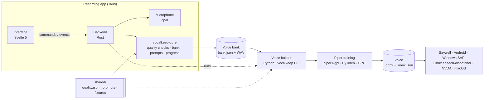

# Architecture

Vocalkeep has three parts that share one data format and one set of quality rules.



## Repository layout

```text
crates/vocalkeep-core/   Rust library: quality checks, WAV, voice bank, prompt sets, progress, exports
desktop/                 The recording app
  src/                   Svelte 5 interface (views, components, demo backend for the browser)
  src-tauri/             Tauri 2 backend: commands, microphone, settings, pipeline runner
pipeline/                The voice builder (Python package and `vocalkeep` command)
shared/
  quality.json           Quality thresholds used by both Rust and Python
  prompts/               Sentence sets with eSpeak NG phonemes
  fixtures/              Recordings with expected verdicts, tested by both implementations
scripts/                 Versioning, release notes, prompt and fixture tools
docs/                    Documentation and screenshots
```

## Recording app

- **Interface** (`desktop/src`): Svelte 5 with runes and TypeScript. Views are in `views/`; app-wide
  state is a small store (`lib/state.svelte.ts`); every backend call goes through `lib/api.ts`.
  Large type (Atkinson Hyperlegible Next), light/dark/high-contrast themes, four text sizes,
  reduced motion, full keyboard control and screen-reader labels.
- **Backend** (`desktop/src-tauri`): commands in `commands.rs`. The microphone runs on its own
  thread (`recorder.rs`, cpal), mixing to mono at the device's rate and emitting a level reading
  about 20 times a second. Stop keeps recording 300 ms longer so last words aren't cut.
- **Takes**: a recording is checked (`vocalkeep_core::quality`), written to `pending/`, and only
  moved into the bank when kept. `bank.json` is saved atomically after every change.
- **Pipeline runner** (`pipeline.rs`): finds the `vocalkeep` command, runs it with arguments built
  from checked values (no shell), and forwards its JSON progress lines to the interface.
- **Security**: strict content security policy, minimal Tauri capabilities, no network access.

## Core library

`vocalkeep-core` has no GUI or audio-device dependencies, so it's fast to test on every platform:

- `quality`: the take and room checks ([quality-checks.md](quality-checks.md)).
- `bank`: the voice bank ([voice-bank-format.md](voice-bank-format.md)), with path checks.
- `prompts`: built-in sentence sets (compiled in from `shared/prompts`), the weighted, fatigue-aware
  queue, and the phoneme inventory.
- `progress`: milestones, sound and sound-pair coverage, per-set and per-day counts.
- `export`: backup zips, safe restore, and the legacy-messages folder with its offline web page.
- `build_info`: version, build number, commit and date, embedded at build time.

## Sentence sets

| Set | Sentences | Source | Licence |
| --- | --- | --- | --- |
| Sound-rich sentences | 1,081 | CMU ARCTIC, 51 sentences left out | [CMU ARCTIC licence](../shared/prompts/LICENSES/CMU-ARCTIC.txt) |
| Everyday conversation | 400 | Written for Vocalkeep | CC0 |
| Short phrases | 150 | Written for Vocalkeep | CC0 |
| Your own phrases | — | The person | Theirs |

A session takes sentences from each set in turn, weighted 3 : 2 : 1 (plus the person's own
phrases), skipping anything already kept. On tired days it picks the shortest of the next few.
Each prompt carries its eSpeak NG phonemes (`scripts/annotate_prompts.py`), the same phonemizer
Piper uses, which is how the Progress page counts sounds covered.

## Voice builder

See [training.md](training.md) and [using-your-voice.md](using-your-voice.md). In short:
`prepare` (re-check, trim, level, resample, `metadata.csv`) → `train` (piper1-gpl from a starting
voice checkpoint, licence checked) → `export` (ONNX, config, model card, `voice.json`) →
`package`/`install` (Saywell and Sherpa-ONNX, SherpaTTS, VoiceGarden, Sonata, speech-dispatcher).

## Versions and builds

One version for everything, in [`VERSION`](../VERSION). `scripts/bump-version.sh` writes it into
`Cargo.toml`, `desktop/package.json`, `tauri.conf.json` and the Python package;
`scripts/check-version.sh` (run in CI) fails if any disagree. The build number is the GitHub
Actions run number, embedded in the app (Settings › About) and in macOS bundles. See
[releasing.md](releasing.md).
